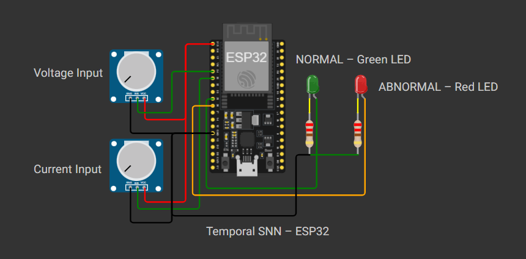
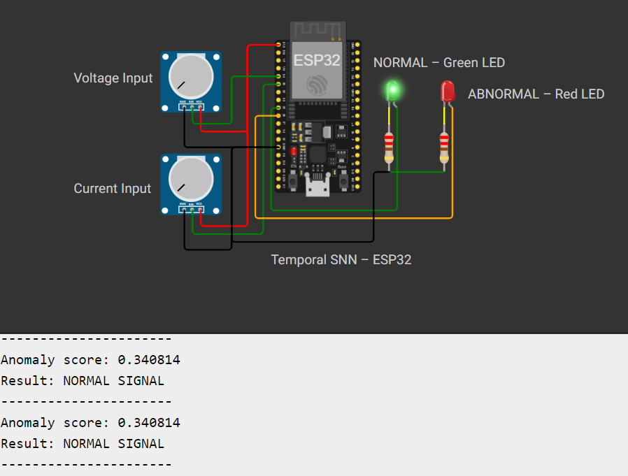
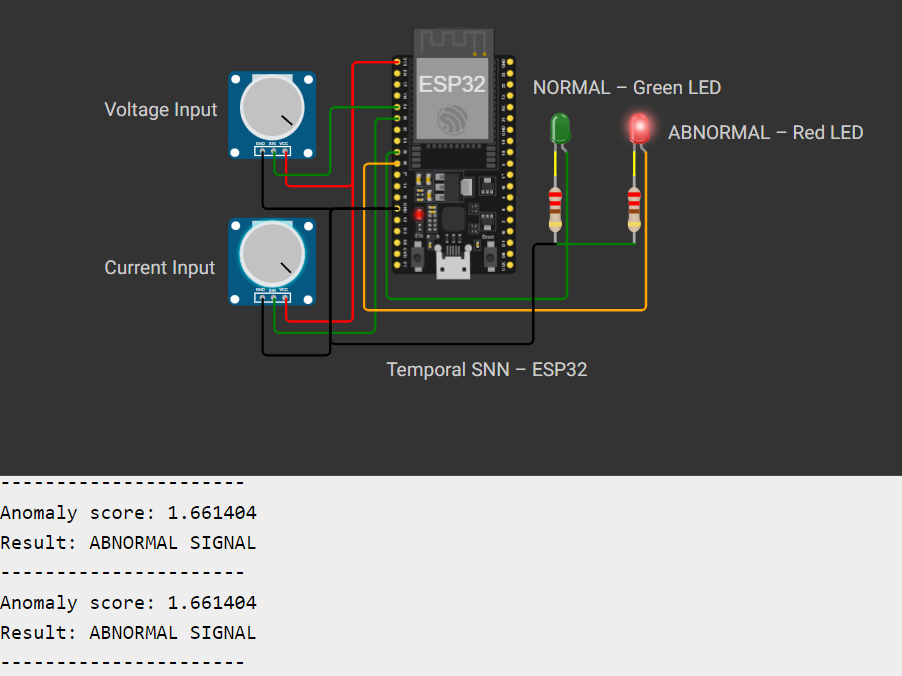

# Temporal SNN-Based Electrical Signal Anomaly Detection

**A Neuromorphic Computing Approach for Temporal Electrical Signal Classification Using Spiking Neural Networks and ESP32**

---

## 1. Project Overview

Electrical signal abnormalities can indicate unusual operating conditions in electrical systems. Detecting these patterns is important for monitoring and identifying potential faults.

This project develops a Temporal Spiking Neural Network (SNN)-based anomaly detection system that analyzes time-dependent electrical signal patterns and classifies them into normal and abnormal categories.

The system combines temporal spike encoding, Leaky Integrate-and-Fire (LIF) neurons, machine learning classification, and ESP32 embedded implementation.

An ESP32-based prototype is demonstrated using Wokwi simulation.

## 2. Project Objectives

- Generate normal and abnormal electrical signal datasets.
- Convert temporal electrical signal features into spike-based representations.
- Develop a Spiking Neural Network-based classification pipeline.
- Evaluate the model using classification metrics.
- Export model parameters for ESP32 implementation.
- Demonstrate anomaly indication using LEDs in Wokwi simulation.

## 3. System Workflow

The overall project follows this sequence:

```text
Electrical Signal Generation
          |
          v
Data Preprocessing
          |
          v
Temporal Spike Encoding
          |
          v
Spiking Neural Network
          |
          v
Anomaly Classification
          |
          v
Model Evaluation
          |
          v
Model Parameter Export
          |
          v
ESP32 Implementation
          |
          v
Wokwi Simulation
          |
          v
Normal / Abnormal Indication
```

## 4. Project Architecture

The model uses temporal features and a spike-based neural processing pipeline.

**Main processing stages:**

1. Signal generation: Generate electrical signal samples representing normal and abnormal conditions.
2. Spike encoding: Transform signal information into temporal spike-based features.
3. Neural processing: Process encoded features using Leaky Integrate-and-Fire (LIF) neurons.
4. Classification: Use a Ridge classifier readout to distinguish normal and abnormal patterns.
5. Embedded deployment: Export model parameters into a C/C++ header file for ESP32 integration.

## 5. Technologies Used

| Category | Technologies |
|---|---|
| Programming languages | Python, C/C++ |
| Numerical processing | NumPy |
| Machine learning | Scikit-learn |
| Neural computing | Spiking Neural Networks |
| Neuron model | Leaky Integrate-and-Fire |
| Embedded platform | ESP32 |
| Circuit simulation | Wokwi |
| Development tools | Visual Studio Code, Git, GitHub |

## 6. Repository Structure

```text
Temporal-SNN-Anomaly-Detection/
│
├── data/
│   ├── electrical_signals.csv
│   ├── electrical_trials.csv
│   ├── spike_encoded_signals.csv
│   └── spike_encoded_trials.csv
│
├── embedded/
│   ├── export_model.py
│   ├── snn_model.h
│   └── verify_model.py
│
├── results/
│   ├── classification_results.csv
│   ├── confusion_matrix.png
│   ├── performance_metrics.csv
│   └── [Other evaluation results]
│
├── signal_generation/
│   └── [Signal generation scripts]
│
├── snn_model/
│   └── [SNN model implementation]
│
└── README.md
```

## 7. Model Architecture

The temporal SNN processing pipeline consists of:

- Temporal feature representation
- Fixed input weight projections
- Leaky Integrate-and-Fire (LIF) hidden neurons
- Ridge classifier readout

The LIF neurons process temporal information through membrane potential dynamics and spike generation.

The resulting neural features are used by the classifier to identify abnormal signal patterns.

## 8. Model Performance

The model was evaluated using a separate test dataset.

| Evaluation Metric | Test Result |
|---|---:|
| Accuracy | 85.00% |
| Precision | 98.00% |
| Recall | 81.67% |
| F1-Score | 89.09% |
| Balanced Accuracy | 88.33% |

The results demonstrate high precision in identifying abnormal patterns. Recall indicates that some abnormal samples were not detected, providing an opportunity for further improvement.

## 9. Embedded System Implementation

The trained model parameters are exported into a C/C++ header file for integration with the ESP32.

**Embedded platform:** ESP32-WROOM-32

**Model header:**

`embedded/snn_model.h`

The ESP32 implementation reads analog input values, processes the inputs, and provides normal or abnormal indications.

## 10. Wokwi Simulation

The embedded implementation is demonstrated using the Wokwi online simulator.

**Simulation components:**

- ESP32-WROOM-32
- Two potentiometers to simulate voltage and current inputs
- Green LED for normal indication
- Red LED for abnormal indication
- 220Ω resistors for LED current limiting

**GPIO Connections:**

| Component | ESP32 GPIO |
|---|---|
| Voltage input potentiometer | GPIO 34 |
| Current input potentiometer | GPIO 35 |
| Green LED | GPIO 25 |
| Red LED | GPIO 26 |

**System indications:**

- Green LED: Normal condition
- Red LED: Abnormal condition

### Wokwi Simulation Link

[Open ESP32 Wokwi Simulation](https://wokwi.com/projects/480132170161519617)

### Circuit Diagram



### Normal Condition



### Abnormal Condition



*Note: The potentiometers are simulated analog inputs, not physical voltage or current sensors. The demonstration is conducted in a virtual environment and has not been validated on real electrical equipment.*

## 11. How to Run the Project

### Python Model

1. Clone the repository.
2. Open the project directory in Visual Studio Code.
3. Install the required Python dependencies.
4. Run the signal generation and SNN model scripts from their respective directories.

### Export the Model

Run the following command from the project root:

```bash
python embedded/export_model.py
```

The exported model header is saved as:

```text
embedded/snn_model.h
```

### ESP32 and Wokwi

1. Open the ESP32 project in Wokwi.
2. Configure the ESP32, potentiometers, LEDs, and resistors.
3. Start the simulation.
4. Adjust the potentiometer inputs.
5. Observe the Serial Monitor and LED indications.

## 12. Limitations and Future Scope

- Integration of actual voltage and current sensors.
- Calibration of embedded inputs to match model preprocessing.
- Testing with real-world electrical signal datasets.
- Improvement of anomaly detection recall.
- Exploration of trainable SNN architectures.
- Further optimization for embedded deployment.

## 13. Project Information

**Project Title:** Temporal SNN-Based Electrical Signal Anomaly Detection

**Domain:** Neuromorphic Computing and Embedded Systems

**Platform:** ESP32 and Wokwi

**Repository:** [GitHub - Temporal SNN Anomaly Detection](https://github.com/anusha-kv/Temporal-SNN-Anomaly-Detection)

---

**Keywords:** Spiking Neural Networks, Neuromorphic Computing, Temporal Signal Processing, Anomaly Detection, LIF Neurons, ESP32, Embedded Systems, Machine Learning.